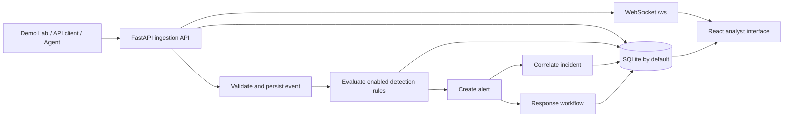

<div align="center">

# SENTINEL SOC
### Security Operations & Incident Response Lab

**Detect. Investigate. Respond. Protect.**

An educational, full-stack SOC platform for exploring security telemetry, rule-based detection, incident workflows, and safety-conscious response automation.

<br>


<br>

| **Web interface** | `http://localhost:5173` |
|:---|:---|
| **API and interactive docs** | `http://localhost:8000/docs` |
| **Health check** | `http://localhost:8000/health` |
| **Live event channel** | `ws://localhost:8000/ws` |

</div>

---

## Contents

1. [At a glance](#at-a-glance)
2. [What you can explore](#what-you-can-explore)
3. [How the system fits together](#how-the-system-fits-together)
4. [Technology](#technology)
5. [Run locally](#run-locally)
6. [Sign in](#sign-in)
7. [Explore a detection workflow](#explore-a-detection-workflow)
8. [Detection rules](#detection-rules)
9. [Response modes and safety](#response-modes-and-safety)
10. [API and real-time events](#api-and-real-time-events)
11. [Configuration](#configuration)
12. [Docker setup](#docker-setup)
13. [Repository guide](#repository-guide)
14. [Tests and project docs](#tests-and-project-docs)
15. [Known scope and limitations](#known-scope-and-limitations)
16. [Security and responsible use](#security-and-responsible-use)

---

## At a glance

SENTINEL SOC is a hands-on security operations center (SOC) project. It brings together a React analyst interface, a FastAPI service, a relational database, event-driven detection rules, incident records, and a response-action ledger. It is designed for learning and controlled demonstrations: the demo lab produces **synthetic** events so a user can follow an attack-shaped signal through triage and response without running an attack.

The backend stores normalized telemetry, evaluates enabled rules, creates alerts, correlates related activity into incidents, and records response actions. The web app presents that activity through a set of analyst workspaces, while a WebSocket endpoint provides a live connection for frontend updates.

> **Project status:** educational lab / capstone-style application. This repository does not establish production readiness, independent security certification, or suitability as a real monitoring or containment service.

## What you can explore

<table>
  <tr>
    <td width="50%"><strong>📡 Telemetry & monitoring</strong><br>Submit events through the API, inspect stored events, view endpoint records, and connect to the live monitor.</td>
    <td width="50%"><strong>🧭 Detection & triage</strong><br>Explore eight seeded rules, generated alerts, severity and status workflows, and ATT&CK technique labels.</td>
  </tr>
  <tr>
    <td><strong>🗂️ Incident investigation</strong><br>Review correlated cases, timelines, investigation details, and analyst notes.</td>
    <td><strong>⚙️ Response workflow</strong><br>View simulated actions, approval requests, execution state, audit records, and rollback actions.</td>
  </tr>
  <tr>
    <td><strong>🧪 Demo lab</strong><br>Generate controlled authentication, network, process, file-integrity, and endpoint activity scenarios.</td>
    <td><strong>📊 Operations views</strong><br>Use dashboards, network views, investigation tools, reports, audit logs, and settings.</td>
  </tr>
</table>

The application routes include Dashboard, Live Monitor, Events, Alerts, Incidents, Endpoints, Network, Detection Rules, Automated Response, Investigation, Reports, Audit Logs, Demo Lab, Settings, and Login.

## How the system fits together



**Typical event path**

1. A synthetic scenario or API client sends a structured event to the backend.
2. The API validates and stores the event.
3. Enabled rules evaluate the event and relevant recent records. A match can create an alert.
4. The service associates the alert with an incident and may create a response action according to its configured workflow.
5. Analysts review events, alerts, incidents, response actions, and audit records in the interface.

The FastAPI app mounts its domain routers under **`/api/v1`**. Interactive API documentation is available at `/docs` while the service is running.

## Technology

| Area | Project technology | Role |
|:--|:--|:--|
| Frontend | React 18, TypeScript, Vite | Analyst interface and development server |
| Styling & charts | Tailwind CSS, Recharts, Framer Motion | Dark visual theme, charts, and interface motion |
| Backend | Python, FastAPI, Pydantic | REST API, request validation, and WebSocket endpoint |
| Persistence | SQLAlchemy, SQLite by default | Relational models and local development database |
| Optional database | PostgreSQL | Container-compose database service |
| Authentication | JWT and password hashing | Login and authenticated API workflows |
| Packaging | Docker Compose | Containerized frontend, backend, and PostgreSQL services |

## Run locally

### Requirements

- Python 3.11 or newer
- Node.js and npm for a manual frontend setup, or the repository's bundled Node runtime for the Windows launcher
- Windows for the supplied one-click `.bat` launcher; manual commands can also be run on other platforms

### Windows quick start

From the project directory, double-click `start_sentinel_soc.bat`, or run:

```bat
start_sentinel_soc.bat
```

The launcher checks Python and the bundled Node runtime, starts the backend and frontend in separate terminal windows, and opens the frontend. Keep both service windows open while using the app. On first backend startup, the application creates database tables and seeds baseline records.

### Manual setup

Open two terminals from the repository root.

**Terminal 1 — backend**

```powershell
python -m venv .venv
.venv\Scripts\Activate.ps1
python -m pip install -r backend\requirements.txt
python scripts\seed_db.py
python -m uvicorn backend.app.main:app --host 127.0.0.1 --port 8000 --reload
```

On macOS or Linux, activate the environment with `source .venv/bin/activate` instead.

**Terminal 2 — frontend**

```powershell
cd frontend
npm install
npm run dev
```

Open `http://localhost:5173`. The Vite development server proxies `/api` and `/ws` to the backend at `http://localhost:8000`.

### Optional endpoint agent

In another terminal, run:

```powershell
python agent\main.py
```

The included agent currently sends an initial startup event and periodic endpoint heartbeats. It is a lightweight demonstration scaffold; it does not continuously collect operating-system security logs. Agent settings can be supplied through the environment variables listed under [Configuration](#configuration).

## Sign in

The development seed script creates three demonstration users:

| Role | Username | Password |
|:--|:--|:--|
| Administrator | `admin` | `SentinelAdmin2026!` |
| Analyst | `analyst` | `SentinelAnalyst2026!` |
| Viewer | `viewer` | `SentinelViewer2026!` |

These are **public demo credentials**. Use them only in a local demonstration, and replace or disable them before exposing an instance to other users or networks. The actual permissions enforced by the API should be confirmed in the route dependencies; interface labels alone are not an authorization boundary.

## Explore a detection workflow

1. Sign in and open **Demo Lab**.
2. Trigger one of the available synthetic scenarios (for example, a password-spray or file-modification simulation).
3. Open **Events** or **Live Monitor** to inspect the generated telemetry.
4. Review any resulting item in **Alerts**, then follow the related case in **Incidents**.
5. Inspect the action and its recorded outcome in **Automated Response** and **Audit Logs**.
6. Use **Reset** in the Demo Lab if you want to clear generated synthetic records.

The demo routes are implemented under `/api/v1/demo`; consult `/docs` for the exact request methods, parameters, and responses exposed by the running version.

## Detection rules

The seed data configures eight rules. Rule metadata (threshold, time window, severity, ATT&CK mapping, and recommendation) is stored in the database. Detection behavior is implemented in `backend/app/detection/engine.py`; the table below summarizes the seeded catalog rather than asserting every recommended response is automatically carried out.

| ID | Seeded rule | Detection signal | ATT&CK technique |
|:--|:--|:--|:--|
| `DET-001` | SSH brute-force authentication | Repeated failed logins from a source within a time window | `T1110` — Brute Force |
| `DET-002` | Successful login after failures | A successful login after recent failures from the same source | `T1078` — Valid Accounts |
| `DET-003` | Port reconnaissance | Port-scan event or activity across destination ports | `T1046` — Network Service Discovery |
| `DET-004` | Privilege escalation | Privilege-escalation event or qualifying `sudo` activity | `T1548` — Abuse Elevation Control Mechanism |
| `DET-005` | Suspicious process execution | Process telemetry matched against process heuristics | `T1059` — Command and Scripting Interpreter |
| `DET-006` | File-integrity alteration | File-modification or file-integrity event | `T1565` — Data Manipulation |
| `DET-007` | Password spraying | Failed logins targeting multiple accounts from a source | `T1110.003` — Password Spraying |
| `DET-008` | Unusual endpoint activity | Endpoint, system, or anomaly-category activity | `T1496` — Resource Hijacking |

Rule thresholds and behavior are configurable and may evolve. See [Detection Rules](docs/DETECTION_RULES.md) and [Database Schema](docs/DATABASE_SCHEMA.md) for the project specifications.

## Response modes and safety

The response engine supports these modes:

| Mode | Behavior |
|:--|:--|
| `simulation` | Uses the mock firewall adapter for IP actions and records the outcome without changing the host firewall. This is the configured default. |
| `approval_required` | Records a pending action and creates an approval record for review. |
| `lab_enforcement` | Can call host firewall commands for supported IP-block actions. This is intended only for a controlled, authorized lab. |

The enforcement path validates IP targets against configured allowed ranges and protected addresses before running supported firewall commands. The project also records action status and audit details and provides rollback workflows. These controls should not be treated as a guarantee of safe or complete rollback: operating-system behavior, privileges, and command differences matter. In particular, use **simulation mode** unless you have reviewed the implementation and are working in an isolated environment you own.

## API and real-time events

The API prefix is `/api/v1`. Common route groups include:

| Area | Route group |
|:--|:--|
| Authentication | `/api/v1/auth` |
| Dashboard | `/api/v1/dashboard` |
| Events | `/api/v1/events` |
| Alerts | `/api/v1/alerts` |
| Incidents | `/api/v1/incidents` |
| Endpoints | `/api/v1/endpoints` |
| Detection rules | `/api/v1/rules` |
| Response actions | `/api/v1/response` |
| Demo scenarios | `/api/v1/demo` |
| Reports and audit | `/api/v1/reports`, `/api/v1/audit` |

Use `http://localhost:8000/docs` as the source of truth for each route's exact method, payload, authentication requirements, and response model. The WebSocket lives at **`/ws`** (outside the REST prefix); clients send `ping` to receive `pong` and receive server broadcasts when connected.

## Configuration

The backend reads environment variables and an optional `.env` file. Start with [`.env.example`](.env.example). Important settings include:

| Variable | Purpose | Default behavior |
|:--|:--|:--|
| `DATABASE_URL` | SQLAlchemy connection string | Local SQLite database `./sentinel_soc.db` |
| `SECRET_KEY` | Signs authentication tokens | Development fallback in source; set a unique secret for any shared deployment |
| `DEFAULT_RESPONSE_MODE` | Default response workflow | `simulation` |
| `WAZUH_ENABLED` | Wazuh connector setting | Disabled |
| `WAZUH_API_URL`, `WAZUH_USER`, `WAZUH_PASSWORD` | Wazuh connection settings | Local example values; configure only if integrating |
| `SENTINEL_BACKEND_URL` | Agent API base URL | `http://127.0.0.1:8000/api/v1` |
| `SENTINEL_API_KEY` | Agent request header value | Demonstration placeholder |
| `SENTINEL_HEARTBEAT_INTERVAL` | Agent heartbeat interval in seconds | `15` |
| `SENTINEL_POLL_INTERVAL` | Agent loop interval in seconds | `5` |

Do not commit real secrets. The checked-in example values and source fallbacks are for local development and are not suitable for a network-accessible deployment.

## Docker setup

Docker Compose defines a PostgreSQL service, the FastAPI backend, and an Nginx-served frontend:

```bash
docker compose up --build
```

Then open `http://localhost` or `http://localhost:5173`. The compose file includes development fallback credentials and secrets. Set appropriate environment values before using it beyond a local disposable demo. Review `docker-compose.yml` and both Dockerfiles for ports, build contexts, and runtime behavior.

## Repository guide

```text
.
├── agent/                  # Lightweight endpoint startup / heartbeat sender
├── backend/
│   ├── app/
│   │   ├── api/            # FastAPI route modules
│   │   ├── core/           # Settings, database, and security helpers
│   │   ├── detection/      # Rule evaluation engine
│   │   ├── models/         # SQLAlchemy entities
│   │   ├── response/       # Response actions, modes, and adapters
│   │   ├── services/       # Event, alert, incident, dashboard, report logic
│   │   └── websocket/      # WebSocket connection manager
│   ├── tests/              # Backend tests
│   ├── Dockerfile
│   └── requirements.txt
├── docs/                   # Architecture, API, detection, schema, demo, testing
├── frontend/
│   ├── src/
│   │   ├── components/     # Reusable UI, layout, and visualization components
│   │   ├── contexts/       # Authentication and WebSocket contexts
│   │   ├── pages/          # Analyst workspace screens
│   │   └── services/       # Frontend API client
│   ├── Dockerfile
│   └── package.json
├── scripts/                # Database seed and service launch scripts
├── .env.example            # Example configuration
├── docker-compose.yml      # Local container orchestration
├── start_sentinel_soc.bat  # Windows convenience launcher
└── sentinel_soc.db         # Local SQLite database, if present
```

The checked-in database is a local development artifact. Back up any data you care about before deleting or replacing it; seeding an existing database adds missing baseline records and does not serve as a general reset or migration system.

## Tests and project docs

To run the backend test suite from the repository root:

```bash
python -m pytest backend/tests
```

Additional project documentation:

| Document | Contents |
|:--|:--|
| [Architecture](docs/ARCHITECTURE.md) | Components, processing flow, and design notes |
| [API Documentation](docs/API_DOCUMENTATION.md) | API usage reference (verify against live `/docs` where details differ) |
| [Detection Rules](docs/DETECTION_RULES.md) | Rule catalog and intended signals |
| [Incident Response](docs/INCIDENT_RESPONSE.md) | Incident workflow and response concepts |
| [Database Schema](docs/DATABASE_SCHEMA.md) | Persistent entities and relationships |
| [Demo Guide](docs/DEMO_GUIDE.md) | Demonstration scenarios |
| [Testing](docs/TESTING.md) | Test instructions and coverage notes |
| [Project Report](docs/PROJECT_REPORT.md) | Longer project background and evaluation |
| [Build Status](BUILD_STATUS.md) | Build notes and status snapshot |

## Known scope and limitations

- The demo scenarios are synthetic. They exercise application workflows; they do not validate detection against a real enterprise telemetry stream.
- The endpoint agent sends a startup event and heartbeats; continuous system-log collection is not implemented in its current loop.
- The seeded detection catalog and implementation should be checked together. Some descriptions and recommended actions are broader than the event checks currently implemented.
- A Wazuh setting and UI surface exist, but a complete, validated production SIEM integration should not be assumed from those alone.
- SQLite is convenient for local use. The repository's PostgreSQL option does not by itself provide production deployment hardening, scaling, backup policy, or migration management.
- The included demo accounts, source fallback secret, CORS defaults, and container defaults require review and replacement before any shared or exposed deployment.
- API documentation in `docs/` may describe paths or behavior that differ from the current router code. The running OpenAPI page is the best reference for actual route definitions.

## Security and responsible use

Use this project on systems and networks you own or are explicitly authorized to test. Start in **simulation** mode. Do not expose a demo deployment to the public internet with the included credentials or secrets. Before experimenting with lab enforcement, inspect the response implementation, confirm the target allowlist, use an isolated disposable lab, and understand the firewall commands and rollback behavior for your operating system.

---

<div align="center">

**SENTINEL SOC** · A learning platform for security operations workflows

</div>
