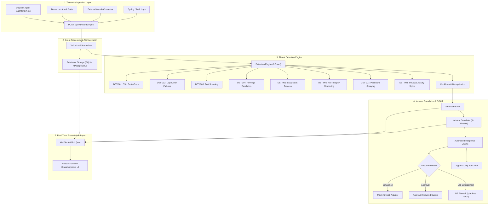

# SENTINEL SOC — System Architecture Specification

## 1. High-Level Architectural Overview

SENTINEL SOC (Security Operations and Automated Incident Response Platform) is structured around a modular, reactive, service-oriented architecture designed to deliver sub-second log ingestion, real-time threat detection, automated incident correlation, dynamic SOAR containment, and glassmorphic visualization.

---

## 2. Event Processing Pipeline

The end-to-end event life cycle follows a strict zero-loss pipeline:
1. **Ingestion**: Raw JSON or syslog events are submitted via authenticated API requests.
2. **Normalization**: Timestamps are parsed to UTC, IP addresses are validated and checked for RFC1918 compliance, event categories are mapped, and severities are standardized.
3. **Storage**: The normalized event and its raw log string are persisted in the `events` table with index optimization on `(source_ip, timestamp)` and `(hostname, timestamp)`.
4. **Threat Detection**: The event is evaluated against all active rules in `detection_rules`.
5. **Alerting**: If thresholds are satisfied and the alert is outside cooldown windows, a unique `ALT-...` alert is created.
6. **Correlation**: Related alerts and events matching the attacker IP or target endpoint within a 1-hour window are clustered into a persistent `INC-...` incident case.
7. **Playbook Execution**: The response policy triggers the associated playbook (`PB-001`, `PB-002`, or `PB-003`). Under Simulation mode (default), the mock firewall logs the block without touching host configurations.
8. **Real-Time Streaming**: Broadcast messages (`NEW_EVENT`, `NEW_ALERT`, `NEW_INCIDENT`, `RESPONSE_ACTION`) are pushed to all connected analyst dashboards over WebSockets.

---

## 3. Technology Stack Justification

| Component | Technology | Architectural Rationale |
|---|---|---|
| **Frontend Framework** | React 18 + TypeScript + Vite | Lightning-fast HMR, strict type safety, modular component lifecycle. |
| **Styling & Theme** | Tailwind CSS + Glassmorphism | Custom translucent dark obsidian aesthetics (`#070a13`), backdrop blur (`20px`), neon accents matching reference designs. |
| **Data Visualization** | Recharts | Smooth SVG spline time series, dual-column resource charts, circular radial health gauges. |
| **Backend Framework** | Python 3.11 + FastAPI | Async high-throughput REST APIs, native OpenAPI Swagger documentation, ASGI WebSocket integration. |
| **Data Access Layer** | SQLAlchemy 2.0 ORM | High-performance query abstractions, multi-dialect support (SQLite for zero-config portable lab runs, PostgreSQL for enterprise production). |
| **Security & Auth** | Argon2 / Bcrypt + JWT (HS256) | Zero plaintext credentials, stateless RBAC authorization, secure token expiration. |
| **Automated Response** | SOAR Framework | Configurable 3-tier execution modes with reversible rollback and immutable audit records. |
