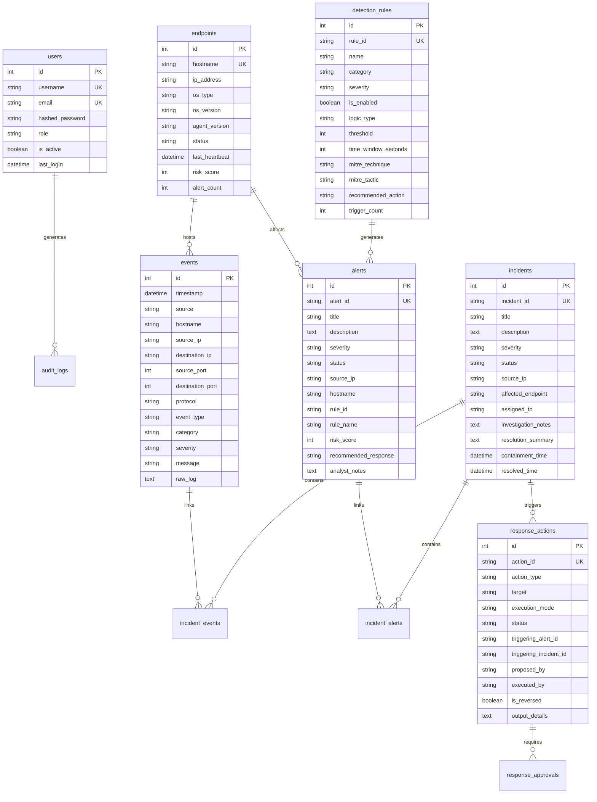

# SENTINEL SOC — Database Architecture Specification

## 1. Entity-Relationship Diagram

---

## 2. Table Specifications

### 1. `users`
Stores analyst, administrator, and auditor credentials, roles, and status. Passwords are cryptographically salted using bcrypt.

### 2. `endpoints`
Maintains hardware, networking, and OS telemetry for all monitored endpoints. Updated via periodic heartbeats.

### 3. `events`
Stores normalized log telemetry. Indexed on `(source_ip, timestamp)` and `(hostname, timestamp)` for high-throughput sub-millisecond query evaluation.

### 4. `detection_rules`
Defines the 8 detection algorithms, MITRE ATT&CK mappings, thresholds, and time windows.

### 5. `alerts`
Security alert cases created when detection criteria are satisfied. Includes risk scoring (0-100) and lifecycle statuses (`new`, `acknowledged`, `investigating`, `resolved`, `false_positive`).

### 6. `incidents`
Correlated incidents clustering related alerts and events by attacker IP, target host, and time proximity.

### 7. `incident_events` & 8. `incident_alerts`
Junction tables maintaining relational integrity between incidents, raw telemetry events, and alerts.

### 9. `response_playbooks`
Configuration templates for automated SOAR containment playbooks (`PB-001`, `PB-002`, `PB-003`).

### 10. `response_actions`
Log of every proposed, approved, executed, and rolled-back containment action.

### 11. `response_approvals`
Authorizations and rejection decisions recorded during Approval-Required mode.

### 12. `audit_logs`
Append-only immutable audit trail recording user logins, rule updates, response actions, and system changes.

### 13. `api_keys`
Hashed API tokens for endpoint agents.

### 14. `system_settings`
Dynamic key-value storage for global response modes (`simulation`, `approval_required`, `lab_enforcement`), retention policies, and Wazuh connector parameters.

### 15. `file_integrity_records`
Monitored system configuration baselines and SHA-256 cryptographic checksums.
